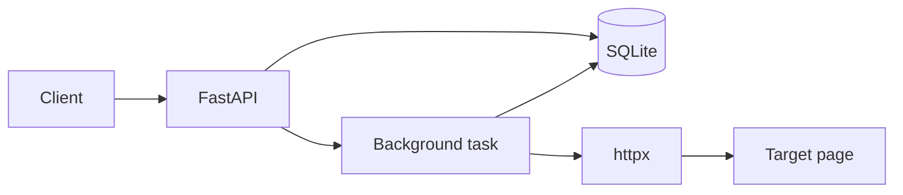

# LinkVault

一个链接采集与收藏 API：提交 URL，抓取网页标题和描述，保存到 SQLite，并提供搜索和分页。

## 为什么做这个项目

- 同时练习 Web 后端和爬虫，不是两个互不相干的 Demo
- 业务闭环短：提交、抓取、入库、查询
- 可以自然加入异常处理、测试、日志和部署
- 不需要前端，FastAPI 的 `/docs` 就是演示界面

## MVP 范围

### 必须完成

- [ ] `POST /links` 提交 URL
- [ ] 抓取网页标题和 meta description
- [ ] 保存链接、标题、描述、状态、错误和时间
- [ ] `GET /links` 支持分页和关键字搜索
- [ ] 重复 URL 不重复入库
- [ ] 超时、重试、限速和日志
- [ ] 解析器测试和接口测试
- [ ] README 和一键启动说明

### 可选

- [ ] API Key 或简单 JWT 认证
- [ ] Dockerfile
- [ ] 部署到 Render/Railway/Fly.io
- [ ] GitHub Actions 跑 pytest

### 暂时不做

- 复杂前端
- Redis、Celery、消息队列
- 分布式爬虫
- 验证码破解和复杂反爬
- 大规模并发抓取

## API 草案

| 方法 | 路径 | 说明 |
| --- | --- | --- |
| GET | `/health` | 健康检查 |
| POST | `/links` | 提交 URL 并创建抓取任务 |
| GET | `/links` | 分页、搜索、按状态筛选 |
| GET | `/links/{id}` | 查看单条详情 |
| DELETE | `/links/{id}` | 删除记录（可选） |

## 数据模型草案

```text
Link
- id
- url
- title
- description
- status        pending / fetching / success / failed
- error_message
- created_at
- updated_at
```

## 架构草案



## 里程碑

1. 爬虫函数：输入 URL，输出标题和描述
2. SQLite 表结构和 CRUD
3. FastAPI 接口和 `/docs` 调试
4. 后台抓取与状态更新
5. 测试、Docker、README、Demo

## 验收标准

- 新 URL 提交后，状态能从 pending 变成 success 或 failed
- 失败时能看到错误信息，不是只有 500
- 重复提交同一 URL 不会产生重复记录
- 分页和搜索可用
- 测试可以在干净环境运行
- 别人按 README 能在 10 分钟内启动

## 安全与合规

- 只抓取允许访问的公开页面，遵守 robots.txt 和服务条款
- 默认限速，不并发轰炸目标站点
- 不接受 `file://`、内网地址等危险 URL，避免 SSRF
- 不抓取个人隐私数据，不绕过登录、验证码或访问控制
- Cookie、Token、数据库文件不提交到 Git

